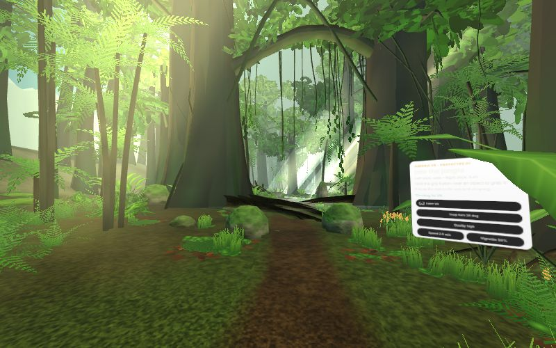
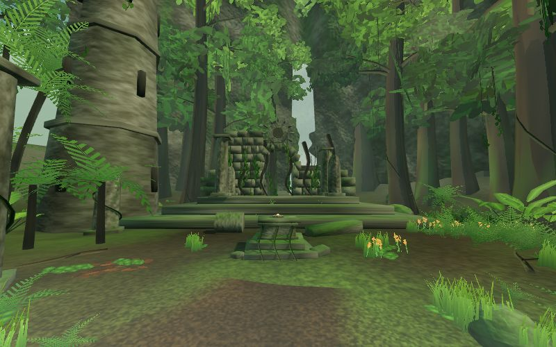

# JUMANJI VR — Prototype 04: the jungle, and the mountain above it

An original, Jumanji-inspired jungle adventure for **Meta Quest 2**, built as real
WebXR (not a 360 video, not a flat 3D page) on Meta's
[Immersive Web SDK](https://developers.meta.com/horizon/documentation/iwsdk/) (IWSDK, on Three.js), in TypeScript.

From the root arch a **side trail climbs a mountain**: a summit overlook above a deep valley, a cliff-ledge descent where the ground collapses under you,
a rope bridge over a gorge, and a terrace beside the brink of a giant waterfall (see [docs/ENVIRONMENT_SHOWCASE.md](docs/ENVIRONMENT_SHOWCASE.md)).

Walk a winding trail from a dense **Jungle Entrance**, along a layered **Forest Trail**
(ford, pool, root arch, a fallen giant), to the **Ancient Clearing** with its overgrown
temple, and pick up the **Heartstone** from the altar.




> **Status:** desktop and emulated-Quest-2 workflows are tested. **Nothing has been run on a
> physical headset yet**, so frame rate and comfort are unmeasured. The project now ships an in-VR
> diagnostics panel and a repeatable headset test ([docs/HEADSET_TESTING.md](docs/HEADSET_TESTING.md))
> to produce the first real numbers. See
> [docs/DEVELOPMENT_PROGRESS.md](docs/DEVELOPMENT_PROGRESS.md) for the evidence and the exact
> device checklist.

## Requirements

- **Node.js** 20.19+, 22.12+ or 24+ (`.nvmrc` pins 22.12.0). The scene generator and validator
  need **22.18+** (native TypeScript stripping); normal development does not, because their output is committed.
- Current Chrome or Edge for desktop development; a Quest 2 on the same Wi-Fi for headset tests.

## Install and run

```sh
npm install
npm run dev     # https://localhost:8081 + the IWSDK managed browser (emulated Quest 2)
```

| Command | What it does |
| --- | --- |
| `npm run dev:status` | Dev URLs, including the LAN URL for the Quest |
| `npm run dev:down` | Stop a background dev session |
| `npm run typecheck` | TypeScript check |
| `npm run validate` | World sanity: nothing floats, no intersecting trunks, trail lane clear, every area reachable |
| `npm run stats` / `stats:check` | Triangle/draw/texture/build-time budget + visible estimate per viewpoint (`:check` fails when over) |
| `npm run perf:probe` | Headless render probe: exact draws/triangles/visible cells, **foliage overdraw per class**, shader-program counts at the three test poses x both tiers (timings are software-GL, relative only). Saves `perf-results/probe-*.json` |
| `npm run audit` | Runtime performance audit at 17 stations (exact draws/triangles/programs/memory/overdraw/per-system CPU; needs `npm run dev:runtime`) |
| `node tools/relief.mjs` | Plan-view shaded relief of the height model with the route overlaid (PNG in `perf-results/`) |
| `node tools/shot.mjs --views summit,brink` | Stills of named stations from the real scene (needs `npm run dev:runtime`) |
| `npm run wildlife` / `npm run wildlife:browser` | Wildlife verification: 41 headless checks (synthesis, perch fit, 72 Hz simulation) / 15 desktop-browser checks (audio unlock, positional audio, draw calls, plant reaction); `tools/wildlife-shots.mjs` takes stills of the creatures |
| `node tools/scale-audit.mjs` | Real-world size table of every prototype + camera/fog/speed facts |
| `node tools/flicker-test.mjs --label x` / `zfight-scan.mjs` / `shadow-walk.mjs` | Structure-flicker diagnosis: depth stability, far-plane clipping, coplanar surfaces, shadow stability |
| `node tools/eye-shots.mjs --out artifacts/scale/x --figure 1` / `visible-report.mjs` | Eye-height stills with a 1.8 m reference figure / what is really drawn from a viewpoint |
| `node tools/walk-test.mjs` / `collapse-test.mjs` | Locomotion/edge tests on the bridge, summit, terrace, ledge; the collapse event scenarios (approach, onshelf, retreat, reset) |
| `npm run dev:runtime` | Dev server only (no browser window): use this for the headset |
| `npm run build` | Production build into `dist/` |
| `npm run verify` | typecheck + validate + stats:check + build |
| `npm run scene:generate` | Regenerate the scene JSON and baked data from the layout rules |

## Controls

| | Quest 2 controllers | Desktop (dev) |
| --- | --- | --- |
| Walk | Left thumbstick | `W A S D` / arrows |
| Turn / look | Right thumbstick (snap turn, 30° default) | Hold **right mouse button** and drag |
| Grab | Hold **grip** near the stone | n/a |
| Hands | Pinch near the stone | n/a |

The **expedition board** at the start of the trail shows live WebXR status and toggles: snap-turn
angle (30/45/60 deg or smooth), walking speed, vignette, and **quality** (high / low). Settings persist.

## URL options (add to the address)

| Option | Effect |
| --- | --- |
| `?area=entrance` / `trail` / `clearing` / `altar` or `?start=x,z` | Start in that place (test an area without walking 70 m) |
| `?area=climb` / `ridge` / `summit` / `summit-down` / `summit-fall` / `descent` / `ledge` / `cleft` / `bridge-west` / `bridge-mid` / `bridge-cascade` / `brink` | Start at a mountain station, at its heading and head pitch (desktop) |
| `?move=hand` / `?reduced=1` / `?seated=1` | Comfort: thumbstick follows the left controller; no bridge sway/ground tremor (vignette >= 50 %); raise the view 0.4 m for seated play |
| `?quality=low` | No real-time shadows, no light shafts/mist, tighter vegetation distances |
| `?wildlife=0` / `1` | Switch the animals (birds, monkeys, butterflies, dragonflies, gnats, fireflies) off / on; also the board's **Wildlife** button |
| `?audio=0` | No sound at all (the AudioContext is never created); also the board's **Sound** button. Sound starts only after a click / key / touch or entering VR |
| `?debug` | Console telemetry: position, heading, FPS, draw calls, triangles, visible cells |
| `?governor=0` / `1` | Turn the adaptive quality governor off / force it on (it is off during `?test=`) |
| `?test=all` | The whole headset suite: 11 stations (jungle + mountain), JSON per station in `perf-results/` |
| `?hazard=0` | Turn off the automatic slow-down on the bridge, steep descent and cliff ledges |
| `?perf=1` / `0` | Diagnostics: wrist panel in VR (left controller), text overlay on the flat page. Also a board toggle |
| `?test=entrance` / `trail` / `clearing` | Repeatable perf test: fixed pose and heading, 8 s warm-up, 10 s sample, JSON result (`&warmup=` `&sample=` seconds, `&desktop=1` to run without VR) |
| `?hz=90` | Ask the XR session for another display rate (the browser may refuse; the log says) |
| `?turn=smooth&snap=45&speed=2.5&vignette=0.5` | Comfort overrides |
| `?xrscale=0.8&foveation=0.5` | Render-scale / foveation experiments |

## Testing on a Meta Quest 2

Full procedure, Windows firewall rule, the 3-pose x 3-run measurement plan and the compatibility checklist:
**[docs/HEADSET_TESTING.md](docs/HEADSET_TESTING.md)**. Short version:

1. `npm run dev:runtime`, note the `Network:` URL `https://<PC-LAN-IP>:8081/`. Allow inbound TCP 8081 in Windows Firewall.
2. Quest on the same Wi-Fi: open `https://<PC-IP>:8081/?perf=1` in the **Meta Quest Browser**, accept the certificate warning, press **Enter VR**.
3. Raise the left controller to read the diagnostics panel. Run the three **Test:** buttons on the board (or `?test=entrance|trail|clearing`).
4. Results land in `perf-results/` on the PC (git-ignored) as JSON. Send them back for analysis.
5. Wired loop: `.claude/skills/iwsdk-native-xr-test/SKILL.md`.

## The mountain in short

| Station | What you find | Try |
| --- | --- | --- |
| Climb | colossal gate trees, switchbacks, mud, roots, views opening as the forest thins | `?area=climb` |
| Summit overlook | a promontory 96 m above the valley floor, distant ranges, the waterfall across the valley | `?area=summit`, `summit-down` |
| Steep descent | a gully and a cliff ledge under hanging vines, the valley below your boots | `?area=descent`, `ledge` |
| Collapse | cracks, pebbles, a tremor, then the shelf drops and you walk through the hollow | `?area=cleft` |
| Rope bridge | 23.6 m over a gorge, 20 m above the river, with the 38 m cascade upstream | `?area=bridge-west` |
| Giant waterfall | a 51 m plunge into a misty pool, seen from a terrace 5 m from the brink | `?area=brink` |

**Physical Quest 2 testing of the mountain has not happened.** `docs/HEADSET_TESTING.md` has the mountain checklist and the `?test=` links for the new stations.

## The world in short

- **Jungle Entrance** (cool, dark, mysterious): colossal gate trees, an overhead limb hung with lianas, thick ferns and broad-leaf plants, ground mist.
- **Forest Trail** (layered, winding): muddy hollows, a shallow **ford** with stepping stones, a **pool** with a cascade, a **root arch** you walk under, a **fallen giant**, a rock outcrop, light shafts, glimpses of the **spire**.
- **Ancient Clearing** (open, warm): wildflowers in the meadow, an **overgrown temple** with a sun-disc relief, ruined pillars, the **altar and Heartstone**, a waterfall cliff as the backdrop.
- **Background depth:** three fogged jungle ridges and a distant spire.
- **Vegetation:** 4 giant/tall/broad/slender tree families, 4 palm species, 3 broad-leaf species, ferns in 3 sizes, tree ferns, shrubs, ground-cover patches, reeds, moss, litter, flowers, fallen logs and branches, exposed roots. Every instance gets its own scale, yaw, ground tilt and colour tint.

## Project layout

```
iwsdk.config.json        project authority: scene, XR, locomotion, grabbing, emulator
src/index.ts             World.create + explicit system registration
src/assets.ts            manifest: landmarks/ruins/water + static-batched vegetation cells
src/world/               layout, mountain landform + route, placement rules, collapse layout, palette (pure), baked.ts (generated)
src/scene-assets/        procedural geometry: terrain, trees, plants, deadwood, rocks, water, temple, chunks ...
src/systems/             atmosphere, collapse, bridge, safety, comfort, relic, water scroll, shimmer, chunk LOD, shadow follow, quality governor, start point, desktop look, debug
src/diagnostics/         frame metrics, wrist/DOM overlay, headset test mode, overdraw meter
src/settings/            comfort + quality tiers
src/panel.ts             expedition board
public/scenes/           main scene (+ test-grab and test-route fixtures)
tools/                   scene generator, validator, budget report, perf probe
docs/                    architecture + progress + screenshots
```

More: [docs/PROJECT_ARCHITECTURE.md](docs/PROJECT_ARCHITECTURE.md) · [docs/DEVELOPMENT_PROGRESS.md](docs/DEVELOPMENT_PROGRESS.md) · [docs/HEADSET_TESTING.md](docs/HEADSET_TESTING.md)

## Originality

All geometry, textures (CPU-generated procedural noise and SDF leaf shapes), layout and the
Heartstone/temple designs are original. No film assets, music, characters or logos are used.
"Jumanji" names the inspiration for the atmosphere only.
