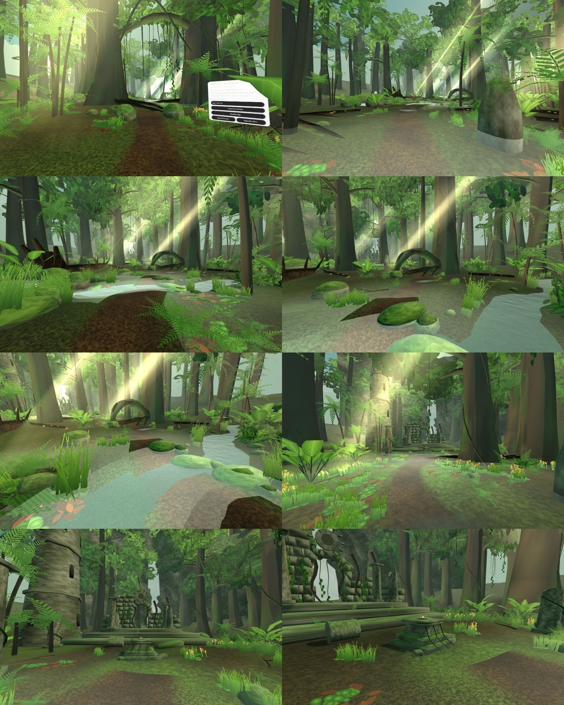
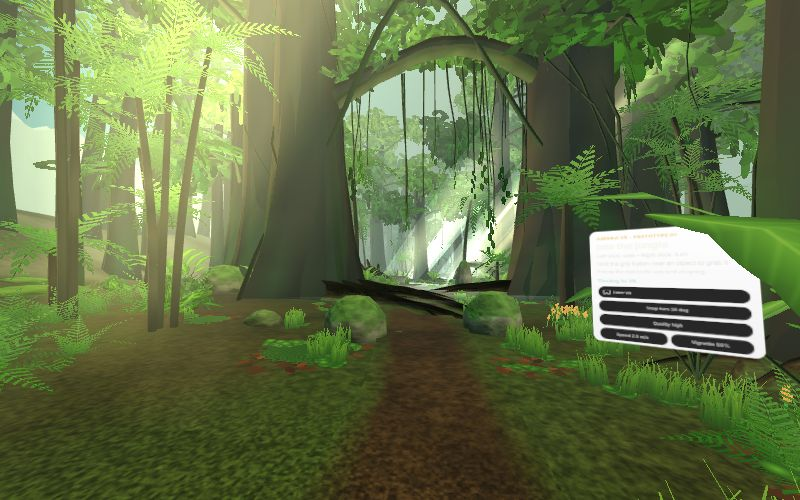
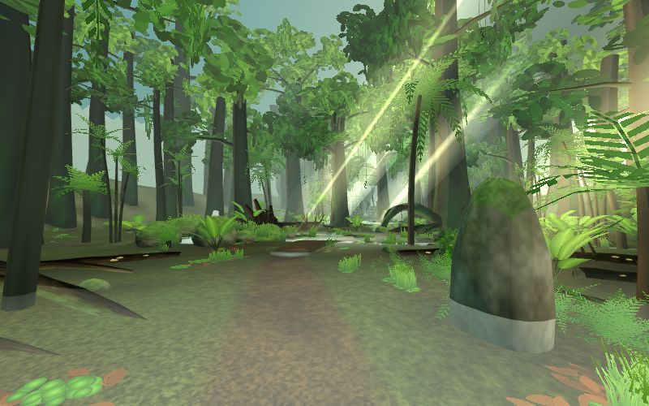
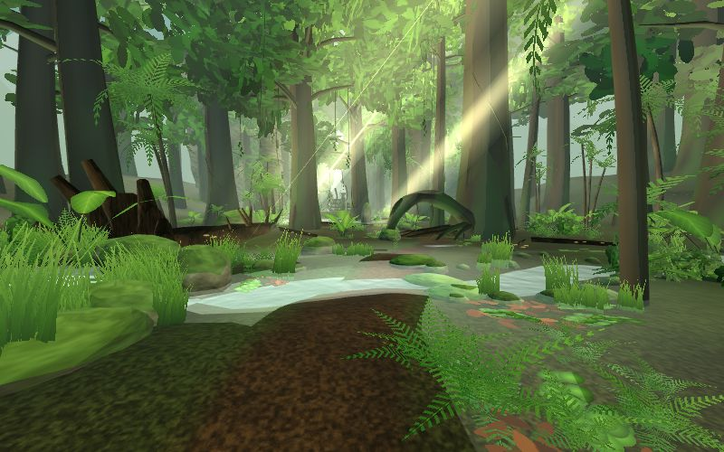
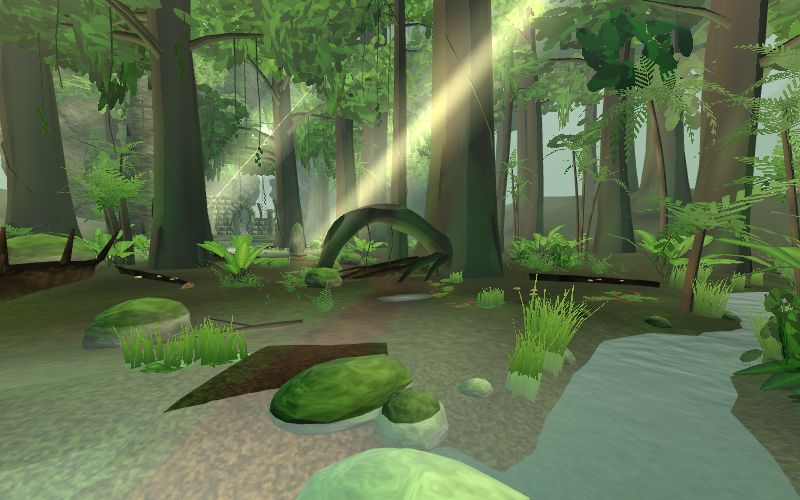
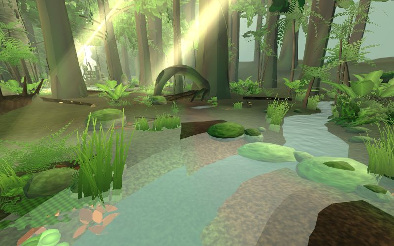
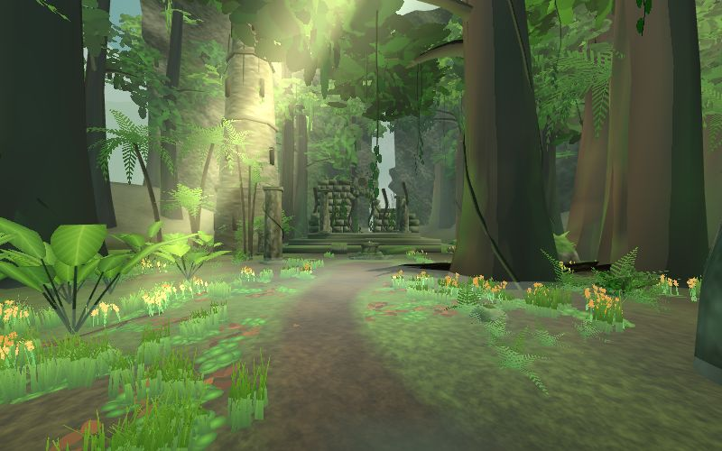
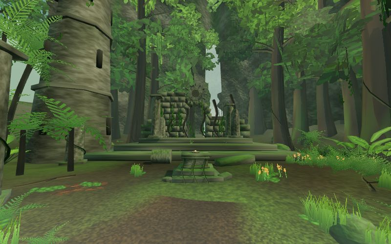
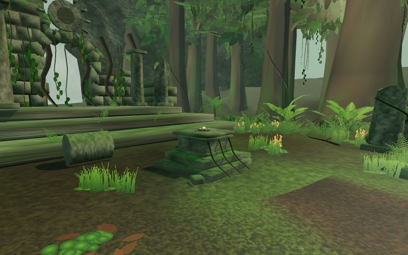

# Jumanji VR: the environment

A walk through the jungle, from the first step to the altar. Stills are rendered from the editor camera at standing eye height (1.65 m) and do not show motion, comfort or frame rate. Nothing has been run on a physical Quest 2 yet.

## 1. Jungle Entrance
Cool, dark and dense. Colossal gate trees, an overhead limb hung with lianas, thick ferns and broad-leaf plants, low ground mist.

## 2. Forest Trail
A winding trail with muddy hollows, layered plants, light shafts, a shallow ford with stepping stones, a pool with a cascade, a root arch and a fallen giant tree.

## 3. Ancient Clearing
Open and warm. Wildflowers in the meadow, an overgrown temple with a sun-disc relief, ruined pillars, and the altar holding the Heartstone. The spire rises above the trees as the destination landmark.

## Numbers (estimates, not frame time)
| Item | Value |
| --- | --- |
| Submitted geometry | about 200k triangles, 119 draw calls |
| Visible per viewpoint (CPU estimate) | 46 to 86 draw calls, 87k to 164k triangles |
| Materials / textures | 12 materials, about 5 MB of textures |
| Procedural build time | about 0.8 s on desktop, est. 3 to 5 s on a Quest 2 |

See `PROJECT_ARCHITECTURE.md` for how it is built and `DEVELOPMENT_PROGRESS.md` for what was verified and what still needs the headset.
